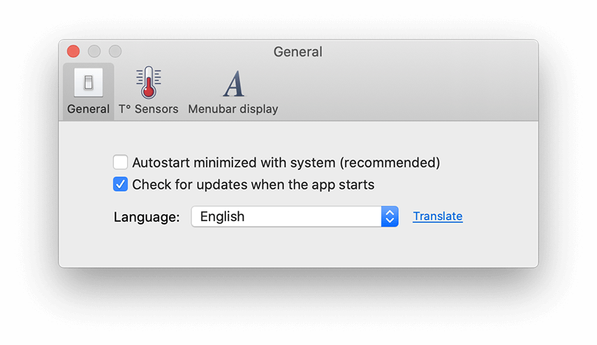
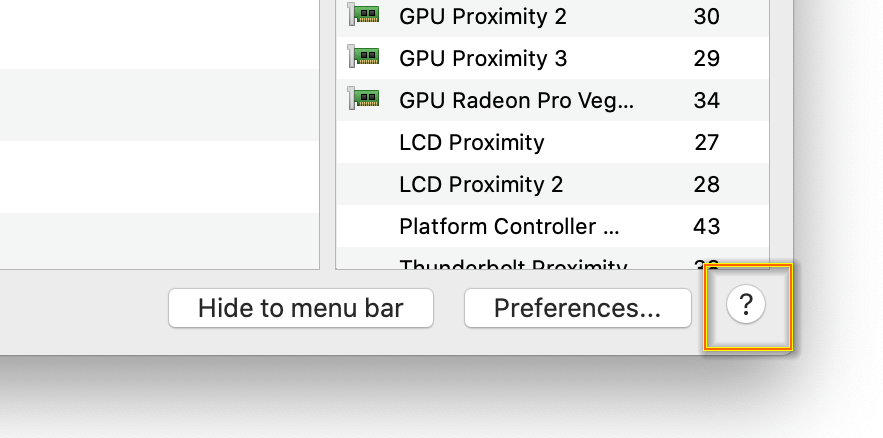
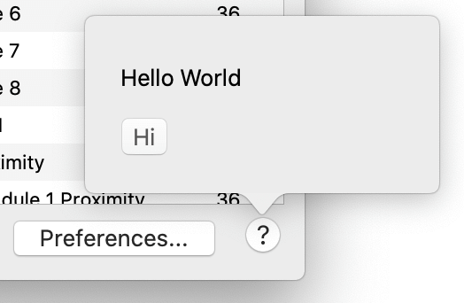
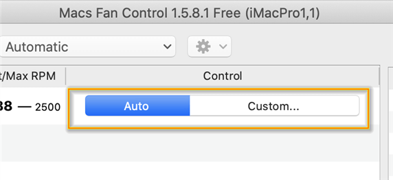
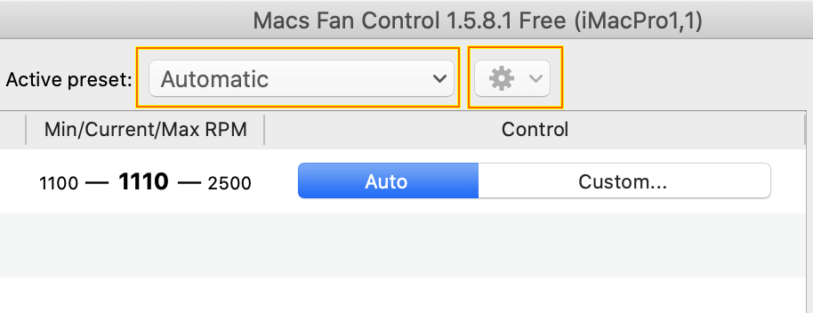

# qcocoacontrols

The library helps to make use of native macOS controls in a Qt app. On Windows (and others?) it's supposed to provide a decent fallback.

Requires Qt 6 (we build it with Qt 6.8) and macOS 12 or later.

Many of those controls are used in our [Macs Fan Control](https://crystalidea.com/macs-fan-control) and [AnyToISO](https://crystalidea.com/anytoiso) apps.

The code is far from being ideal so you're welcome to contribute.

To compile on macOS we use Qt Creator and Visual Studio 2022 Community on Windows

#### linking on macOS

Being a static library by default, qcocoacontrols requires the '-ObjC' flag to be passed to the linker when linking your target app. Otherwise it will crash with something like

``` +[NSImage imageFromQIcon:]: unrecognized selector sent to class 0x7fff8d90cbb0```

The reason for that are customizations for the existing **NSImage** class and bringing those to the target app is not enabled by default ([More info](https://stackoverflow.com/questions/2567498/objective-c-categories-in-static-library)). Adding linker flags can be done by appending them to LIBS in your .pro file:

``` LIBS += -Llib_path -lqcocoacontrols -ObjC```

#### Liquid Glass (macOS 26 and later)

`QCocoaAppearance::design()` tells which design AppKit gives the process: Liquid Glass with macOS 26 and later for an app built against the macOS 26 SDK or later, unless it is built against an SDK older than 27 and sets `UIDesignRequiresCompatibility` in its Info.plist. The controls of the library follow it, so `QCocoaButtonActionMenu` takes the Liquid Glass metrics there.

Under Liquid Glass AppKit draws the title bar of a window in the dark appearance lighter than the window background, while Qt paints the window and its item views in the window background color. `QCocoaAppearance::installWindowContrast()`, called once after the QApplication is created, gives top-level dialogs and main windows in the dark appearance a gray background made of the system colors, as light as the title bar, and keeps it in step with the appearance. In the light appearance the title bar is white like the window, and the windows stay white. In the classic design and on Windows it does nothing.

`QCocoaComboBox` opens its list as a native NSMenu, the way NSPopUpButton does; on other platforms it is a plain QComboBox.

`QCocoaTabWidget` is a QTabWidget whose tabs are the bar of NSTabView under Liquid Glass with macOS 27 and later: an NSSegmentedControl with the tabs role, whose selection is a piece of glass that slides to the chosen tab. The pane and the places of the bar and the pages come from an NSTabView of the same size, so it looks like NSTabView in both appearances and in the small size. QTabBar still keeps the tabs, so the QTabWidget API works as usual; the tabs are always on top, without close buttons, moving, the document mode or corner widgets. On macOS 26 and earlier, in the classic design and on other platforms it is a plain QTabWidget.

## Some examples:

##### QCocoaPreferencesDialog:


##### QCocoaButton with BezelStyle::HelpButton:



##### QCocoaPopover displayed for the help button:



##### QCocoaSegmentedButton:



##### Two examples of QCocoaButtonActionMenu, the second with icon position set to QCocoaButton::IconOnly:


